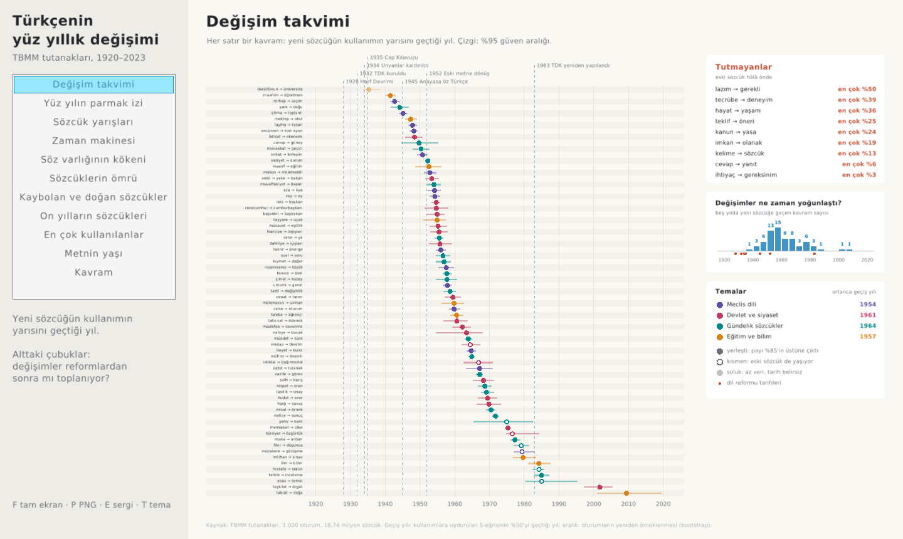
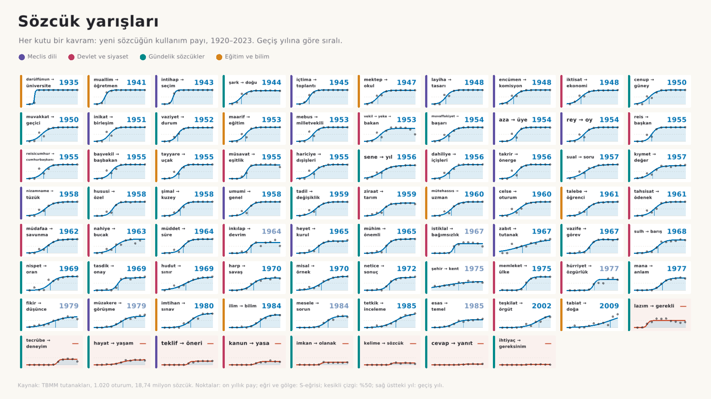
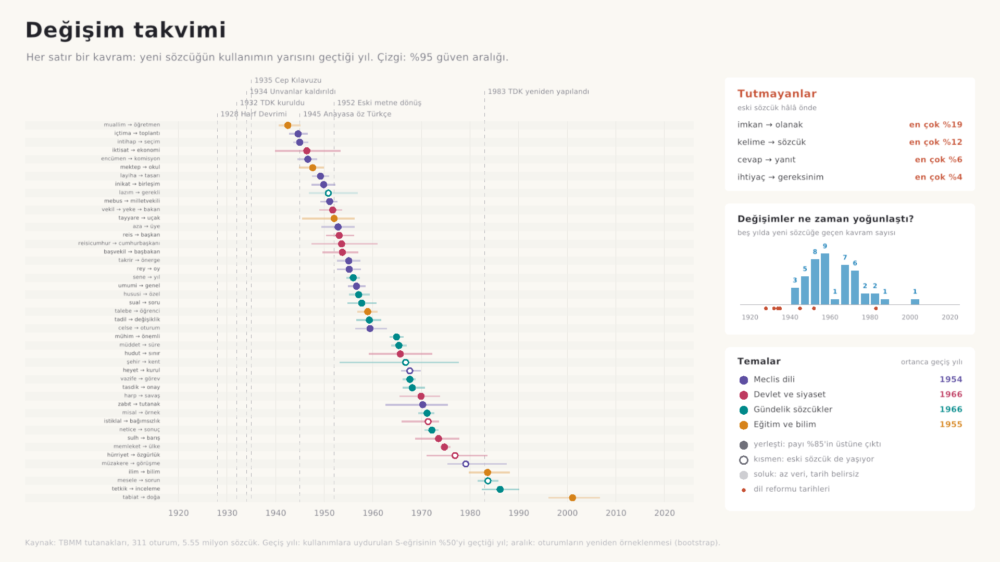
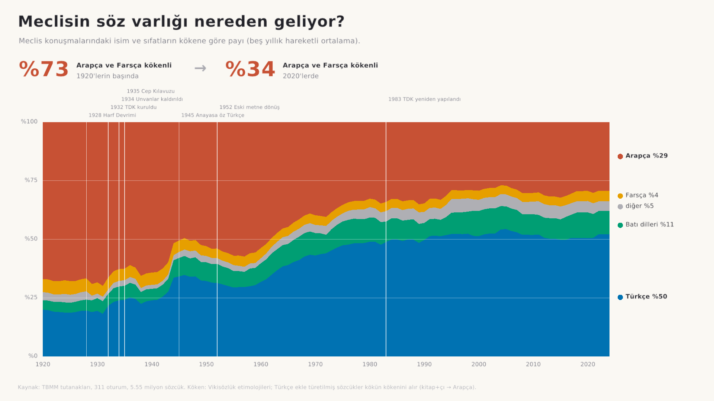
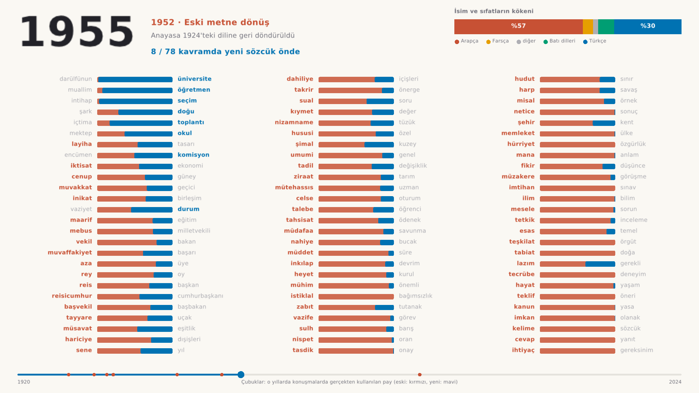
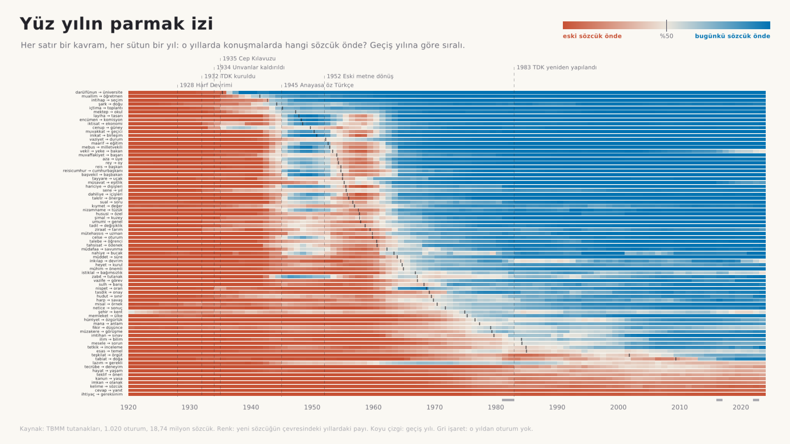
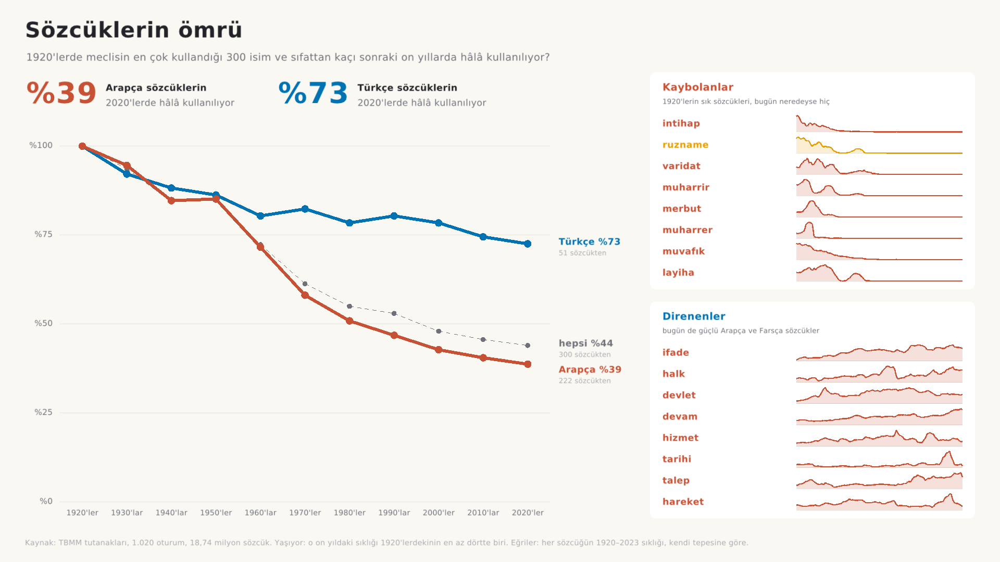
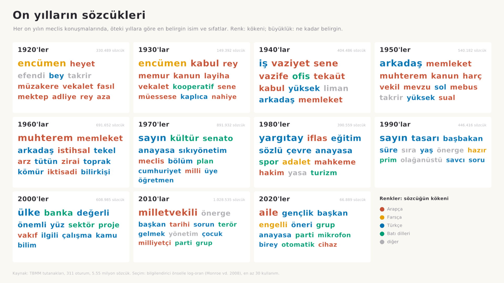

For a Tubitak project we're trying to map and analyze the Turkish languages evolution by time and history.

We will need data around from 1900 to 2000's of text. Let's make sure they're similar type of writings.

We are planning on using C and SQLITE but this isn't a final choice and we are ready to change if we have any problems.

We're open for new ideas! The subject isn't fully decided on so you can tell us if you have any ideas!

---

## What is here

A system that measures how Turkish words were replaced over a century, using one kind of text from start to end: the transcripts of the Turkish parliament (TBMM tutanakları), 1920 to today.

- **Why 1920?** The 1920 transcripts exist in Latin script with the original Ottoman wording. The 1908–1920 Ottoman parliament exists only as Arabic-script scans.
- **How a replacement is measured.** For each meaning (a "concept"), `data/concepts.tsv` lists the competing words, for example *sene* (old) and *yıl* (new). The tools count every inflected form of each word in every sampled sitting.
- **What comes out.** For each meaning: the year the new word passed half of the uses, how long the change took, and how far it went. For the vocabulary as a whole: how much of it was Arabic, Persian, Turkish or Western, year by year.



## Build and run

You need a C compiler, `make`, `curl`, `jq` and `pdftotext` (package `poppler-utils`). The viewer also needs raylib (found with `pkg-config`), and the video needs `ffmpeg`. SQLite and raygui are included in `third_party/`.

```sh
make          # builds evo (the data and analysis tool) and viewer (the charts)
make test     # unit tests: real transcript lines with their OCR mistakes, fits, etymologies
make pilot    # downloads the pilot sample and the dictionary, builds db/corpus.sqlite
./viewer      # the charts; F full screen, P saves a PNG, Space plays, E exhibition mode, T dark theme
make figures  # every chart as a 1920x1080 PNG in out/figures, plus out/fits.tsv and out/origins.csv
make figures-dark  # the same in the dark theme (for projectors), in out/figures-koyu
make web      # the website: out/web/index.html, one file that opens in any browser
make video    # the two animations as MP4 files in out/ (29 s and 44 s, under 4 MB together)
```

The small sample used for the results below is about 260 sittings: 6 volumes × 2 sittings per term. To build it:

```sh
make sample    # downloads data/sample_urls.txt (about an hour, polite to the server) and builds the database
make figures   # then every chart
```

`data/sample_urls.txt` was made by `scripts/sample.sh 6 2 data/sample_urls.txt` (about 20 minutes).

## The pipeline

| Step | Command | Result |
|---|---|---|
| Find sittings | `scripts/discover.sh TBMM 8 12`, `scripts/sample.sh`, `scripts/pilot.sh` | lists of PDF URLs |
| Download, keep the text | `scripts/fetch.sh LIST data/raw` | `data/raw/*.txt` |
| Dictionary | `scripts/lexicon.sh`, then `./evo lexicon …` | word forms and origins (Wiktionary) |
| Clean, date and count | `./evo ingest db/corpus.sqlite data/raw` | words per sitting in SQLite |
| S-curves | `./evo fit db/corpus.sqlite data/concepts.tsv out/fits.tsv` | crossover year, speed and ceiling per meaning |
| Vocabulary origin | `./evo origins db/corpus.sqlite out/origins.csv` | Arabic / Persian / Turkish / Western share per year |
| Two eras compared | `./evo eras db/corpus.sqlite 1920 1934 2003 2023` | the words most typical of each era |
| Charts | `./viewer`, `./viewer --shot takvim out.png`, `make figures` | PNG figures for the report |
| Date a text | `./evo date db/corpus.sqlite text.txt`, `./evo datetest db/corpus.sqlite` | the five years a text most likely comes from; how accurate that is |
| Website | `make web` (`./evo web …`) | `out/web/index.html`: every result and example sentences in one page |

What `ingest` removes before counting, and why:
- **Contents pages and the summary of the previous sitting.** They are clerks' text.
- **Appendices after the last session closes.** These are bills, committee reports and written answers; one 1996 sitting has 28,000 lines of them.
- **Speaker labels** such as `BAŞKAN —` or `MALİYE VEKİLİ … —`. They contain the very words being counted.

It also rejoins hyphenated words, reads the date (including the Ottoman calendar of 1920–25 and OCR-damaged dates, checked against the printed weekday), and skips text layers that were OCR'd without Turkish letters.

## The analysis

- **S-curve per meaning.** Language change follows an S-curve (Kroch 1989): slow start, fast middle, slow end. `evo fit` fits `share = ceiling / (1 + e^(−rate·(year − mid)))` to the yearly uses by maximum likelihood. From it come three numbers:
  - **geçiş yılı (crossover year):** when the new word passed 50% of the uses;
  - **değişim süresi (duration):** how many years it took from 10% to 90% of its ceiling;
  - **tavan (ceiling):** where it levels off.
- **Confidence intervals.** The sittings of each year are resampled 300 times and the curve refitted (a bootstrap). The 95% interval of the crossover year comes from that spread.
- **Status:**
  - *yerleşti*: the ceiling is above 85%;
  - *kısmen*: the new word passed 50%, but the old one still lives;
  - *tutmadı*: the new word never reached half of the uses.
- **Themes.** Every meaning has a theme: meclis, devlet, genel or eğitim. `evo fit` compares the median crossover year of each theme with the rest, using a permutation test.
- **Vocabulary origin.** Each noun and adjective in the corpus gets the origin Wiktionary gives it.
  - A word built with a Turkish suffix takes its root's origin, so *kitapçı* counts as Arabic.
  - Function words (*ve, ama, her*) are left out: many are Arabic or Persian, but they were never replaced.
- **The age of a text.** Every five years has its own word frequencies (*sene* in 1925, *yıl* in 2015). `evo date` guesses when a text was spoken from its words alone: a naive Bayes classifier that adds up, word by word, how much likelier the word is in one period than in another. It uses only the 20,000 most used dictionary word forms, not names, so it reads the language and not the ministers of the day.
  - **The test** (`evo datetest`): every sitting is dated with its whole volume taken out of the model, since sittings of one volume are days apart and share their topics.
  - **Results on the small sample:** off by 4.3 years on average for a whole sitting, 4.9 for 200 words and 10.4 for 20 words (one sentence). Always guessing the middle year would be off by 24.1.
  - **It can be fooled.** It puts Atatürk's *Gençliğe Hitabe* (1927) in the 1970s, because its words (*Türk*, *gençliği*, *istiklalini*) were common in the speeches of that decade. The opening of *Nutuk* (1927) lands in 1935–39.
- **Two eras compared.** `evo eras` ranks words by how typical they are of each era: a log-odds ratio with an informative Dirichlet prior (Monroe, Colaresi & Quinn 2008), so that rare words do not top the list by chance.

## The charts

| View (`--shot` name) | What it shows |
|---|---|
| Değişim takvimi (`takvim`) | Every meaning on one timeline at its crossover year, with interval; the failures; when the changes clustered; median year per theme |
| Sözcük yarışları (`yarislar`) | All S-curves at once, ordered by crossover year (a poster) |
| Söz varlığının kökeni (`koken`) | The share of Arabic, Persian, Turkish and Western words, 1920–2023, with the reform dates |
| Kaybolan ve doğan sözcükler (`sozcukler`) | The words most typical of the 1920s and of today, coloured by origin, with old → new pairs connected |
| Zaman makinesi (`zaman:1950`) | One year at a time: for every meaning, how much the old and the new word were used. Animated in the viewer and in `make video` |
| Kavram (a concept, e.g. `yıl`) | One meaning: each word's share with 95% intervals, the S-curve and the crossover year |
| Yüz yılın parmak izi (`parmakizi`) | Every meaning, every year, as one coloured cell: red when the old word leads, blue when today's word does. The 1950s reversal shows as a red band |
| Sözcüklerin ömrü (`omur`) | Of the 300 most used nouns and adjectives of the 1920s, how many are still in use in each later decade, Arabic against Turkish; with the words that vanished and the Arabic and Persian ones that held on, each with its own curve |
| On yılların sözcükleri (`onyillar`) | The words most typical of each decade against all the others. History shows through: agriculture in the 1960s, martial law in the 1970s, terror in the 2010s |
| En çok kullanılanlar (`siralama:1950`) | Animated: the 12 most used nouns and adjectives of each year as racing bars, coloured by origin. `make video` |
| Metnin yaşı (`tarih`) | How well a text's years are guessed from its words: error by text length against guessing without reading, and every sitting's true year against its guess |
| Sözcük ara (any words, comma separated) | Frequency per million words. Several words are compared on one chart, e.g. `efendi, muhterem, sayın, değerli` (how MPs addressed each other) |

The time machine shows the observed shares (smoothed over a few years), not the S-curves, so reversals stay visible.

**Exhibition mode.** Press E in the viewer: it goes full screen, opens with a title slide, then shows every chart in turn with a caption underneath that says what to see in it (with the numbers from the data). The animations play to the end. Any key or click stops it. It is meant for the stand at the exhibition. Press T for the dark theme, which reads better on a projector.

## The website

`make web` writes the whole study into one web page, `out/web/index.html`: the same charts, interactive, plus real sentences from the transcripts for every word, each linked to its PDF on the TBMM site. It works on a phone, so a QR code on the poster can lead to it; it also opens from disk without a server (the fonts then fall back to the system's).

- `web/template.html` is the page: HTML, CSS and plain JavaScript, no libraries.
- `./evo web DB CONCEPTS RAW_DIR web/template.html out/web` puts the numbers into it as JSON (`out/web/data.json` too).
- The page computes the same smoothed shares and rates as the viewer (`observedAt`, `smoothRate`, the ranking), so the two agree.
- **The first screen** fills the window: an old word is struck through, an arrow appears, and today's word types in letter by letter while a year counter runs to the crossover year.
- Each chapter's title states its finding, with the numbers filled in from the data ("Arapça ve Farsça sözcüklerin payı %73'ten %34'e indi").
- **Metnin yaşı:** paste any text and the page guesses its years, with the telling words coloured by era (red old, blue new).
- **Motion:**
  - charts over time sweep in from left to right the first time they are seen, and the time machine starts by itself;
  - with the system's "reduce motion" setting, or with `#durgun` at the end of the address, nothing moves.
- **A light/dark switch** in the navigation bar.
- **Smooth scrolling:**
  - the menu's links glide to their chapter, and on a phone the menu keeps the current chapter's link in view;
  - the time machine, the ranking and the first screen's animation pause while scrolled out of view and go on when they come back;
  - the bars move with transforms, so a frame never has to lay out the page again.



## Checking the data

- `./evo stats DB`: sittings, words and dictionary coverage per decade.
- `./evo unknown DB 1920 1945`: the most frequent words the dictionary does not know.
- `./evo kwic DB data/raw bakan 20`: 20 random uses of a word in context, to check that it means what we think. Forms that turn out to mean something else go into `data/exclusions.tsv` with the reason.
- `./evo origins DB out.csv` also lists the most frequent words it could not classify.
- `./evo clean data/raw/tbmm08012073.txt`: shows exactly what the cleaner keeps.

## Results so far (small sample)

311 sittings and 5.55 million words, 1920–2023, with the 49 word pairs in `data/concepts.tsv`. The 1936–39 sittings are missing (see below). This is a first look from a small sample and a list of well-known pairs, not final findings. Reproduce it with `make sample && make figures`.



- **The vocabulary of parliament changed by half.**
  - Arabic and Persian words were 73% of the nouns and adjectives used in 1920–24, and 34% in 2020–24.
  - Turkish words rose from 19% to 52%, Western words from 4% to 10% (`out/origins.csv`).
- **Most replacements happened 1945–1960, not right after the reforms of the 1930s.** In 45 of the 49 meanings the new word took over: 23 of those 45 crossed 50% between 1945 and 1959, only 2 before 1945.
- **The 1950s reversal.** After 1952, when the constitution was returned to its 1924 wording, the old official words came back: *vekil, reis, başvekil, mebus, layiha*.
  - The new word was ahead in 20 of 49 meanings in 1950, in only 8 in 1955, and in 28 in 1965.
  - The Arabic share of the vocabulary moved the same way: 51% (1945–49), 57% (1955–59), then down.
- **Parliament's own vocabulary changed first.**
  - Median crossover year: procedure words (meclis) 1954; education and science 1955; state and politics 1966; everyday words 1966.
  - Meclis against all others: 11 years earlier, p = 0.075 (permutation test). Suggestive, not significant with 49 meanings; more pairs from the 1935 guide would settle it.
- **Some replacements never caught on in parliament.**
  - Never above half: *yanıt* (at most 6% of uses), *sözcük* (12%), *olanak* (19%), *gereksinim* (4%).
  - Only partly: *kent* (60%), *görüşme* (76%), *bağımsızlık* (75%), *sorun* (80%), *özgürlük* (80%).
- **Speed varies a lot.** *intihap → seçim* went from 10% to 90% in 15 years; *sene → yıl* took 53, *şehir → kent* 88.
- **Turkish words lasted, Arabic ones did not.** Of the 300 most used nouns and adjectives of the 1920s, 67% of the Turkish ones are still in use in the 2020s (at a quarter of their old frequency or more), but only 35% of the Arabic ones (`omur`). Gone almost entirely: *intihap, muvafık, ruzname, muavenet, mezuniyet*.
- **How MPs address each other changed three times.** *Efendi* (over 10,000 per million words in the 1920s) collapses after the 1934 law that abolished titles; *muhterem* peaks in the late 1950s; *sayın* takes over from the 1960s, and *değerli* rises from the 1970s.
- **The words of each decade follow history** (`onyillar`): *tütün, toprak, zirai* in the 1960s, *sıkıyönetim* and *senato* in the 1970s, *sektör, proje, banka* in the 2000s, *terör* in the 2010s.











## What to watch for

- **Missing Language Reform years.** Most volumes of the 1935–39 term (1936–39) were OCR'd without Turkish letters (*Yüksek mühendis* reads `Yiiksek miihendis`), so `ingest` skips them. They have to be OCR'd again with a Turkish model, e.g. `pdftoppm -r 300` then `tesseract -l tur` (packages `tesseract-ocr` and `tesseract-ocr-tur`). This matters most of all.
- **Words with two meanings.**
  - *bakan* is also "looking";
  - *vekil* now usually means "deputy" (Başkan Vekili);
  - *özel* is also a surname, *barış* a name;
  - *talebe* is also "to the request".
  
  Check every word with `kwic` before relying on its curve.
- **The word list is biased.** The pairs in `data/concepts.tsv` are well-known ones, which overstates how often the Reform succeeded. The real sample should come from the 1935 TDK guide *Türkçeden Osmanlıcaya Cep Kılavuzu* (free scan with OCR text: https://archive.org/details/TurkccedenOsmanlncayaCepKplavuzu). It lists the proposals that failed too.
- **Uncertain curves.** Some are flagged *belirsiz* (wide interval, or a speed at its limit). Report them as uncertain.

## Next steps

1. Re-OCR the 1936–39 scans.
2. Parse the 1935 guide and draw a random sample of its entries; replace or extend `data/concepts.tsv`.
3. A larger download: 15–30 sittings per year.
4. Check every chosen word with `kwic` and record the decisions in `data/exclusions.tsv`.

## Data and licences

- **Transcripts:** TBMM (public records, www5.tbmm.gov.tr).
- **Dictionary:** Wiktionary via kaikki.org, CC BY-SA. Cite Ylonen (2022), *Wiktextract*, LREC.
- **Bundled code:** SQLite 3.53.4 (public domain) and raygui (zlib licence).
